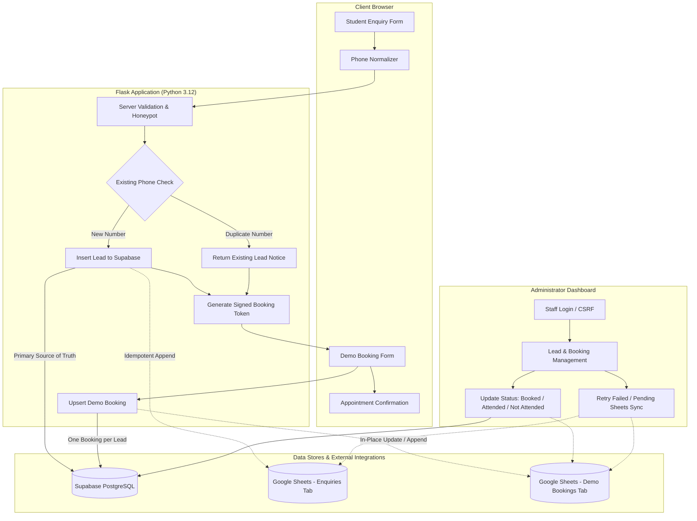

# KMIE Student Enquiry & Demo Booking Automation
**Assessment:** Komali Mam Institute of Excellence (KMIE) — Second Round Practical Assessment  
**Candidate:** Nandini R | **Role:** Software Developer & Automation Intern  
**Max Marks:** 50 | **Time Allowed:** 2 Days  


## 1. Project Overview & Problem Statement

Coaching institutes offering specialized preparation for **NEET** and **JEE** frequently face operational bottlenecks during admission cycles:
1. Leads received via web forms often produce duplicate student profiles due to varied phone formatting (e.g. `9876543210`, `+91 98765 43210`, `0091 98765 43210`).
2. Disconnected spreadsheets and databases lead to lost student records and manual sync errors.
3. Scheduling demo classes requires manual follow-ups, causing drop-offs and scheduling friction.

### Project Objective
Build a production-ready, reliable automation web application that:
- Captures student enquiries with complete validation across Class, Exam Goal, and Course.
- Normalizes phone numbers to canonical E.164 format and prevents duplicate leads.
- Stores enquiries and appointments in **Supabase PostgreSQL** as the primary source of truth.
- Automatically synchronizes records idempotently to **Google Sheets**.
- Provides a frictionless demo class booking workflow with 4 fixed time slots and placeholder meeting details.
- Offers a secure administrative portal for managing bookings, statuses, and spreadsheet sync retries.

---

## 2. System Architecture



---

## 3. Technology Stack

| Layer | Technology | Justification |
|---|---|---|
| **Backend** | Python 3.12, Flask 3.x, Werkzeug | Lightweight, reliable WSGI web framework with clear separation of concerns. |
| **Server Engine** | Gunicorn | High-concurrency production WSGI HTTP server for Render deployment. |
| **Database** | Supabase PostgreSQL | Relational ACID database with check constraints, unique constraints, and RLS. |
| **Phone Normalization** | `phonenumbers` (libphonenumber) | Industry-standard parsing with default region `IN` (India) and E.164 conversion. |
| **Validation & Auth** | `email-validator`, `Flask-WTF`, `itsdangerous` | RFC-compliant email checks, CSRF protection, and cryptographically signed tokens. |
| **External Integration** | `gspread`, `google-auth` | Service-account-authenticated Google Sheets API communication. |
| **Frontend** | HTML5, CSS3, Vanilla JavaScript, Jinja2 | Clean modern light-mode UI (Emerald/Teal accents), responsive grid, accessible controls. |
| **Testing** | Pytest 8.x, pytest-mock | Automated test suite covering all 20 required validation and integration scenarios. |
| **Deployment** | Render Blueprint (`render.yaml`) | Infrastructure-as-code deployment with automatic health check probes. |

---

## 4. Database Design (Supabase PostgreSQL)

SQL migration file: `supabase/migrations/202610130001_init.sql`

### 4.1 `leads` Table
| Column | Type | Constraints | Description |
|---|---|---|---|
| `id` | UUID | PRIMARY KEY, gen_random_uuid() | Unique identifier for lead |
| `student_name` | VARCHAR(120) | NOT NULL, length >= 2 | Student full legal name |
| `phone_e164` | VARCHAR(32) | NOT NULL, UNIQUE, Indexed | Canonical E.164 phone number |
| `email` | VARCHAR(255) | NOT NULL | Student / guardian contact email |
| `class_level` | VARCHAR(10) | CHECK IN ('11', '12') | Enrolled school class |
| `exam_goal` | VARCHAR(10) | CHECK IN ('NEET', 'JEE') | Target competitive exam |
| `interested_course` | VARCHAR(120) | NOT NULL | Configured course selection |
| `sheet_sync_status` | VARCHAR(20) | CHECK IN ('pending', 'synced', 'failed') | Google Sheets synchronization status |
| `sheet_synced_at` | TIMESTAMPTZ | NULLABLE | Timestamp of successful sheet sync |
| `sheet_sync_error` | TEXT | NULLABLE | Sanitized synchronization error details |
| `created_at` / `updated_at` | TIMESTAMPTZ | DEFAULT timezone('utc', now()) | Auto-managed audit timestamps |

### 4.2 `bookings` Table
| Column | Type | Constraints | Description |
|---|---|---|---|
| `id` | UUID | PRIMARY KEY, gen_random_uuid() | Unique identifier for booking |
| `lead_id` | UUID | NOT NULL, REFERENCES leads(id), UNIQUE | One current demo booking per lead |
| `demo_date` | DATE | NOT NULL | Scheduled appointment date (IST) |
| `slot_time` | VARCHAR(10) | CHECK IN ('13:00', '15:00', '17:00', '19:00') | 1 PM, 3 PM, 5 PM, or 7 PM IST |
| `booking_status` | VARCHAR(20) | CHECK IN ('Booked', 'Attended', 'Not Attended') | Current attendance status |
| `sheet_sync_status` | VARCHAR(20) | CHECK IN ('pending', 'synced', 'failed') | Sheets synchronization status |
| `sheet_synced_at` | TIMESTAMPTZ | NULLABLE | Timestamp of sheet update |
| `sheet_sync_error` | TEXT | NULLABLE | Sanitized sync diagnostics |
| `created_at` / `updated_at` | TIMESTAMPTZ | DEFAULT timezone('utc', now()) | Auto-managed audit timestamps |

---

## 5. Google Sheets Integration Structure

Google Sheets contains two dedicated tabs:

### Tab 1: `Enquiries`
| Column A | Column B | Column C | Column D | Column E | Column F | Column G | Column H |
|---|---|---|---|---|---|---|---|
| Lead ID | Submission Timestamp | Student Name | Normalized Phone Number | Email | Class | Exam Goal | Interested Course |

### Tab 2: `Demo Bookings`
| Column A | Column B | Column C | Column D | Column E | Column F | Column G |
|---|---|---|---|---|---|---|
| Booking ID | Lead ID | Student Name | Demo Date | Demo Time | Booking Status | Last Updated |

- **Idempotency**: Retrying enquiry sync checks Column A (`Lead ID`). If present, duplicate rows are prevented.
- **In-Place Updates**: When a booking is rescheduled or its status changes, the existing row in `Demo Bookings` is updated in place.

---

## 6. Setup Instructions

### 6.1 Supabase Setup
1. Create a free Supabase project at [https://supabase.com](https://supabase.com).
2. Go to **SQL Editor** in your Supabase dashboard.
3. Open `supabase/migrations/202610130001_init.sql` and run the entire SQL script.
4. Go to **Project Settings -> API** and copy:
   - **Project URL** (`SUPABASE_URL`)
   - **service_role secret key** (`SUPABASE_SECRET_KEY`)

### 6.2 Google Sheets API & Service Account Setup
1. Open the [Google Cloud Console](https://console.cloud.google.com/).
2. Create a new project (e.g. `kmie-automation`).
3. Enable the **Google Sheets API**.
4. Go to **IAM & Admin -> Service Accounts** and create a service account (e.g. `kmie-sheets-sync@...`).
5. Create and download a new JSON key for this service account.
6. Create a Google Spreadsheet with two tabs: `Enquiries` and `Demo Bookings`.
7. Share the spreadsheet with the service account email (grant **Editor** permissions).
8. Copy the **Spreadsheet ID** from the browser URL:
   `https://docs.google.com/spreadsheets/d/<SPREADSHEET_ID>/edit`
9. Encode your service account JSON file to Base64:
   ```bash
   # Windows PowerShell
   [Convert]::ToBase64String([IO.File]::ReadAllBytes("service_account.json"))
   
   # Linux / Mac
   base64 -w 0 service_account.json
   ```

### 6.3 Local Installation & Environment Setup
1. Clone or navigate to the repository directory:
   ```bash
   cd KMIE
   ```
2. Create and activate a Python virtual environment:
   ```bash
   python -m venv venv
   # On Windows:
   .\venv\Scripts\activate
   # On Linux/Mac:
   source venv/bin/activate
   ```
3. Install dependencies:
   ```bash
   pip install -r requirements.txt
   ```
4. Copy `.env.example` to `.env`:
   ```bash
   cp .env.example .env
   ```
5. Generate an administrator password hash:
   ```bash
   python scripts/generate_admin_hash.py MyAdminPass123!
   ```
6. Fill in the required variables in `.env`:
   ```ini
   APP_ENV=development
   APP_SECRET_KEY=change-this-to-a-secure-random-key
   SUPABASE_URL=https://your-project.supabase.co
   SUPABASE_SECRET_KEY=your-supabase-service-role-secret-key
   GOOGLE_SHEET_ID=your-google-sheet-id
   GOOGLE_SERVICE_ACCOUNT_JSON_BASE64=your-base64-string
   ADMIN_USERNAME=admin
   ADMIN_PASSWORD_HASH=scrypt:32768:8:1$...
   DEMO_MEETING_URL=https://zoom.us/j/placeholder-kmie-demo-session
   ```

---

## 7. Running the Application & Tests

### 7.1 Running the Automated Test Suite
Run the 28 unit and integration tests (mocks external services for zero-dependency execution):
```bash
pytest
```
*All tests pass with 100% green status across validation, normalization, deduplication, booking, and security.*

### 7.2 Seeding Demo Data (5 Sample Records)
Seed the 5 fictitious test records from `sample_data/enquiries.csv` using the reserved `+1 202-555-0101` .. `+1 202-555-0105` range:
```bash
python scripts/seed_demo_data.py --sync-sheets
```

### 7.3 Running the Local Web Server
Start the application:
```bash
python wsgi.py
```
Open your browser at `http://localhost:5000`.

---

## 8. Deployment on Render (`render.yaml`)

This repository includes a production-ready Render Blueprint in `render.yaml`.

### Render Deployment Steps:
1. Push the code to a GitHub repository.
2. Sign in to [Render](https://render.com).
3. Click **New + -> Blueprint** and connect your GitHub repository.
4. Render will parse `render.yaml` and configure:
   - **Environment**: Python 3.12
   - **Build Command**: `pip install -r requirements.txt`
   - **Start Command**: `gunicorn wsgi:app`
   - **Health Check Path**: `/health/live`
5. Supply the required secret environment variables in the Render dashboard:
   - `SUPABASE_URL`
   - `SUPABASE_SECRET_KEY`
   - `GOOGLE_SHEET_ID`
   - `GOOGLE_SERVICE_ACCOUNT_JSON_BASE64`
   - `ADMIN_PASSWORD_HASH`
6. Click **Apply Blueprint**. Render will build and deploy the web service with automatic SSL.

---

## 9. Failure Handling & Resilience Matrix

| Failure Scenario | System Handling | Data Integrity Result |
|---|---|---|
| **Invalid Phone Number** | Caught by `phone_service.py`, rejected before querying DB. Form inputs preserved. | No record created in Supabase; no row in Google Sheets. |
| **Duplicate Phone Number** | Normalized to E.164, caught by pre-query and DB unique constraint. Returns existing lead notice. | No second lead created; no duplicate sheet row appended. |
| **Google Sheets API Outage** | Lead is safely committed to Supabase. `sheet_sync_status` set to `'failed'`. User notified that sync is queued. | Database lead preserved. Admin can retry sync from dashboard without duplicates. |
| **Supabase DB Unreachable** | Web app gracefully catches exception, returns safe 500 error, logs safely without leaking credentials. | No orphaned Sheets records created. |
| **Past Date / Invalid Slot** | Caught by backend date validation against `Asia/Kolkata` local time. Rejected with clear notice. | Existing valid booking is not mutated. |
| **Unauthorized Admin Request** | `@admin_required` decorator intercepts request and redirects to `/admin/login`. | Zero private lead or booking data leaked. |

---

## 10. Assessment Rubric Mapping (50 Marks)

| Part | Marks | Requirement | Implementation Location in Project | Status |
|---|---|---|---|---|
| **Part A.1** | 5 | Enquiry form with Name, Phone, Email, Class (11/12), Exam Goal (NEET/JEE), Course | `app/templates/index.html`, `app/routes/public.py`, `app/services/enquiry_service.py` | Complete |
| **Part A.2** | 7 | Automatically save valid enquiries to Google Sheet with submission timestamp & 5 sample records | `app/services/google_sheets_service.py`, `sample_data/enquiries.csv`, `scripts/seed_demo_data.py` | Complete |
| **Part A.3** | 3 | Clear success or error messages after submission | `app/templates/enquiry_result.html`, `app/routes/public.py` | Complete |
| **Part B.4** | 6 | Check phone exists before adding; normalize formatting (spaces, hyphens, country code, leading 00) | `app/services/phone_service.py` (`normalize_phone_number`), `tests/test_phone_normalization.py` | Complete |
| **Part B.5** | 4 | Avoid duplicate leads; show clear message; demonstrate with automated test | `app/services/enquiry_service.py`, `tests/test_enquiries.py` (`test_duplicate_lead_rejection_different_phone_format`) | Complete |
| **Part C.6** | 7 | Demo date selection (no past dates) + 4 time slots (1 PM, 3 PM, 5 PM, 7 PM) associated with correct lead | `app/routes/booking.py`, `app/templates/booking.html`, `app/services/booking_service.py` | Complete |
| **Part C.7** | 5 | Confirmation message with student name, date, time, and placeholder Zoom URL | `app/templates/booking_confirmation.html`, `DEMO_MEETING_URL` config | Complete |
| **Part C.8** | 3 | Booking status: Booked / Attended / Not Attended | Supabase constraint, `app/routes/admin.py`, Google Sheets sync update | Complete |
| **Part D.9** | 6 | Full flow demonstration guide & architectural data flow documentation | `docs/DEMO_SCRIPT.md`, `docs/ARCHITECTURE.md` | Complete |
| **Part D.10** | 4 | Explanation & automated verification of failure scenarios | `docs/ARCHITECTURE.md` (§4.3), `tests/test_google_sheets.py` (`test_google_sheets_failure_handling`) | Complete |
| **Total** | **50** | **Comprehensive Full-Stack Assessment Implementation** | | **100% Satisfied** |
