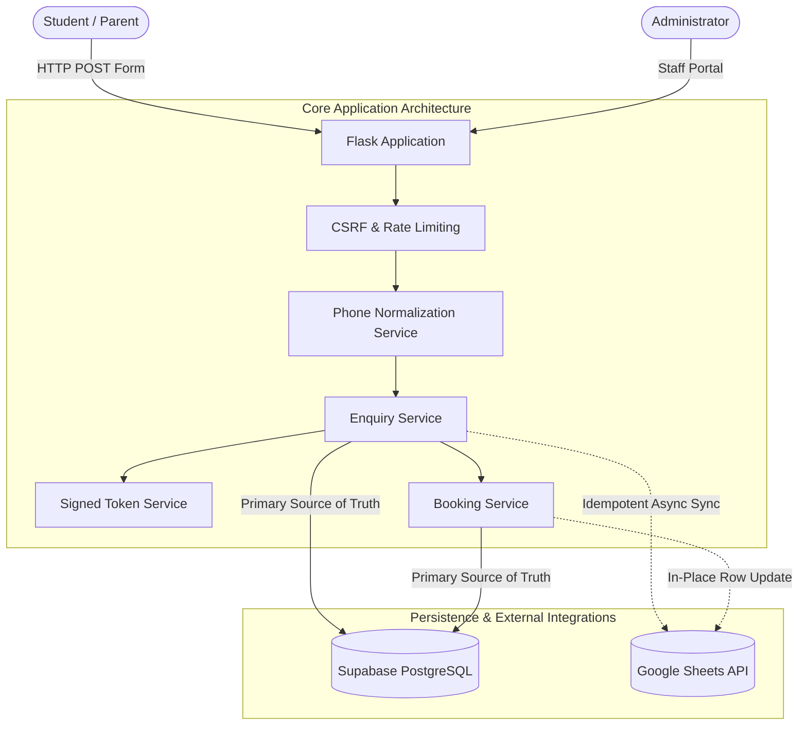
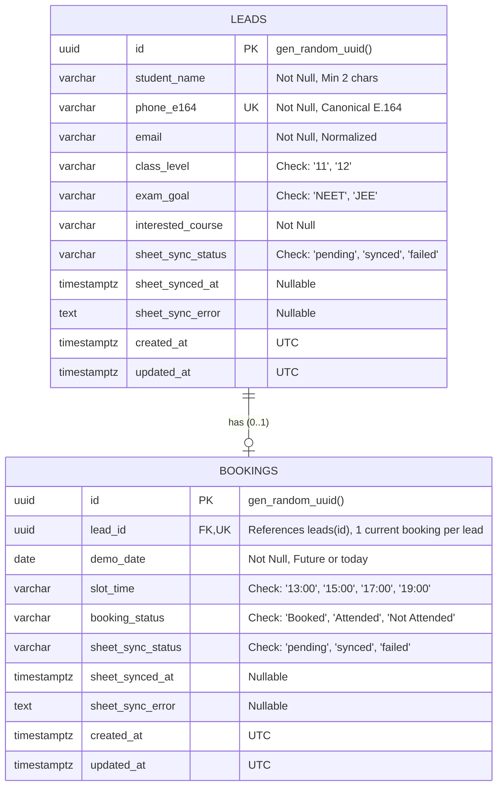

# System Architecture & Technical Specifications

## KMIE Student Enquiry & Demo Booking Automation

---

## 1. Architectural Overview

The KMIE Student Enquiry & Demo Booking system is a resilient full-stack Python web application designed with a **Separation of Concerns** architecture. It prioritizes data integrity, idempotent operations, and transactional consistency.



---

## 2. Core Components & Responsibilities

### 2.1 Backend Layer (`app/`)
- **Application Factory (`app/__init__.py`)**: Implements `create_app()` enabling runtime configuration switching (`development`, `production`, `testing`), registers blueprints, sets security headers, and defines health checks (`/health/live`, `/health/ready`).
- **Configuration (`app/config.py`)**: Environment-based configuration reading secrets from environment variables with sensible defaults for local development.
- **Route Blueprints**:
  - `public.py`: Public-facing student enquiry intake and result screens.
  - `booking.py`: Demo class date and slot selection authorized via cryptographically signed tokens.
  - `admin.py`: Authenticated staff dashboard for lead searching, booking status management, and manual Sheets sync retries.

### 2.2 Service Layer (`app/services/`)
- **`phone_service.py`**: Validates and normalizes phone numbers into canonical E.164 strings (`+919876543210`) using Google's `libphonenumber` (`phonenumbers` Python package).
- **`supabase_service.py`**: Interacts with Supabase PostgreSQL using `supabase-py`. Enforces unique constraints, handles database errors (e.g. SQL code `23505`), and performs relational queries.
- **`google_sheets_service.py`**: Authenticates via Google Cloud Service Account in-memory (using base64-encoded JSON), initializes sheet headers, checks for existing IDs to avoid duplicate rows, and performs bounded exponential backoff retries.
- **`auth_service.py`**: Handles password hashing (`scrypt`), timing-attack-resistant authentication (`hmac.compare_digest`), session authorization decorators, and cryptographic token issuance using `itsdangerous`.
- **`enquiry_service.py` & `booking_service.py`**: Orchestrates end-to-end business workflows.

---

## 3. Database Architecture (Supabase PostgreSQL)

### 3.1 Entity Relationship Diagram



### 3.2 Key Database Invariants
1. **Uniqueness Constraint (`uq_leads_phone_e164`)**: Prevents race conditions from simultaneous requests producing duplicate leads.
2. **One Booking Per Lead (`uq_bookings_lead_id`)**: A student cannot have multiple concurrent demo bookings. Rescheduling mutates the existing record.
3. **Database-Enforced Check Constraints**: Guarantees that invalid class levels, exam goals, or unauthorized time slots cannot be persisted even if application code is bypassed.
4. **Row Level Security (RLS)**: Anonymous browser traffic (`anon` role) is completely denied direct table access. All mutations occur server-side through the backend service role key.

---

## 4. Google Sheets Synchronization Protocol

Google Sheets is a secondary external system; **Supabase is always the primary source of truth**.

### 4.1 Tab Structure
1. **`Enquiries` Tab**:
   `[Lead ID, Submission Timestamp, Student Name, Normalized Phone Number, Email, Class, Exam Goal, Interested Course]`
2. **`Demo Bookings` Tab**:
   `[Booking ID, Lead ID, Student Name, Demo Date, Demo Time, Booking Status, Last Updated]`

### 4.2 Idempotency Strategy
- **Enquiry Synchronization**: Before appending a row to the `Enquiries` tab, column A (`Lead ID`) is searched. If the `Lead ID` is already present, the append operation is skipped, preventing duplicate rows during retry operations.
- **Booking Synchronization**: When a demo is scheduled, rescheduled, or its status changes, column A (`Booking ID`) and column B (`Lead ID`) are checked. If found, the existing row is updated in-place (`ws.update()`). If not found, a new row is appended.

### 4.3 Resilience & Failure Recovery
```mermaid
sequenceDiagram
    participant S as Student
    participant F as Flask App
    participant DB as Supabase
    participant GS as Google Sheets

    S->>F: Submit Enquiry
    F->>F: Normalize Phone (E.164)
    F->>DB: Check & Insert Lead
    DB-->>F: Lead Saved (ID: uuid)
    
    alt Google Sheets Available
        F->>GS: Append Row (with retry)
        GS-->>F: Sync Success
        F->>DB: Update sheet_sync_status = 'synced'
        F-->>S: Success (Sync Completed)
    else Google Sheets Unavailable / Rate-Limited
        F->>GS: Append Row (fails)
        GS-->>F: Error (429 / 503 / Timeout)
        F->>DB: Update sheet_sync_status = 'failed'
        F-->>S: Success (Enquiry Saved; Sync Pending)
    end
```

---

## 5. Security & Privacy Model

1. **Signed Booking Tokens**: When a lead is created or detected as a duplicate, a cryptographically signed token is issued (`URLSafeTimedSerializer`). The student cannot manipulate or forge another student's lead ID.
2. **Spam Prevention (Honeypot)**: Hidden CSS field (`website_url_check`) traps automated form submission bots without burdening real students with captchas.
3. **CSRF Protection**: All browser POST mutations require a server-validated CSRF token via `Flask-WTF`.
4. **Password Security**: Administrator passwords are never stored in plain text. Passwords use Werkzeug's `scrypt` hashing algorithm.
5. **No Secret Leaks**: Base64-decoded service account credentials and Supabase service keys are handled strictly in-memory and excluded from logs, health check responses, and Git version control.
